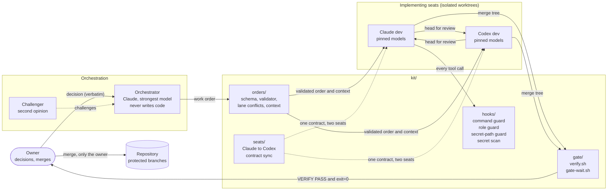
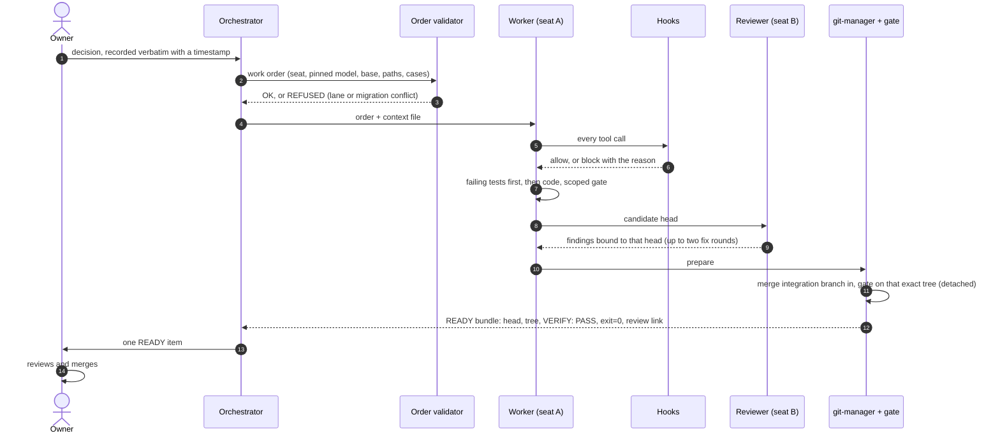

# Agentic Delivery Kit

Guardrails, a single verification gate and a work-order protocol for directing several
AI coding agents (Claude Code and OpenAI Codex) on one codebase, while one human keeps
control of every decision and every merge.

> **How this was built.** The code in this kit, and in the private production project it
> was extracted from, was written by AI coding agents (Claude Code and OpenAI Codex) under
> my direction and review. I designed the process, made the decisions, reviewed the work
> and merged every change. The kit is the process made executable.

## The problem

One AI agent on a codebase is a pair programmer. Several agents across two vendors, running
in parallel for months, is a team, and it fails like an unmanaged team:

- two agents edit the same file from different branches and both "pass";
- an agent pushes to the release branch because nothing on the server stops it (a private
  repository on a free plan has no server-side branch protection);
- an agent reads a credentials file "to check the variable loaded" and the value ends up
  in a transcript;
- a test run is reported green because a piped runner exited 0 on red;
- an expensive model is inherited by every sub-agent, and the bill follows;
- a question asked by two sessions gets two different answers, and both become policy.

This kit is the set of mechanisms that stopped those failures in a real product: hooks
that refuse dangerous tool calls before they run, a gate whose verdict means one thing,
work orders that make delegation explicit and lanes disjoint, and a seat model that keeps
the human as the only one who merges.

## Architecture



| Piece | What it does | Where |
|---|---|---|
| Command guard | Refuses pushes to protected branches, force-push, ref deletion, blind staging, `reset --hard`, unknown git verbs (aliases hide pushes), `gh pr merge`, visibility changes, environment dumps, printing secret-looking variables, and any command that opens a credential-shaped file | `kit/hooks/command-guard.sh` |
| Role guard | A session may only read until it claims a role through its charter; each role has a write scope (the orchestrator may write orders and docs, never code; a reviewer is read-only) | `kit/hooks/role-guard.sh`, `role-scopes.conf` |
| Secret-path guard | Read, Edit, Write, Grep and Glob may not open dotenv files, keys or credential stores, whatever the role | `kit/hooks/secret-path-guard.sh` |
| Secret scan | Baseline scanner over tracked files; reports only new findings, never prints a value, fails on a tracked credential file | `kit/hooks/secret-scan.sh` |
| Gate | One command, fixed phases, a verdict pair (`VERIFY: PASS` and `exit=0`), optional change-scoped test selection | `kit/gate/verify.sh` |
| Gate waiter | Waits on a detached gate's log and refuses stale, partial or contradictory verdicts | `kit/gate/gate-wait.sh` |
| Work orders | JSON schema, validator with lane-conflict refusal, per-order context file | `kit/orders/` |
| Seat model | Roles, agents, commands, and the Claude to Codex contract sync | `kit/seats/`, `.claude/`, `.codex/` |

All guards share one parser and one credential-path predicate (`kit/hooks/guard.py`), so
the shell, the file tools and the role logic cannot disagree about what a secret looks
like. Everything runs on bash and the Python standard library.

## How a change flows



A moved head or a moved integration branch makes the bundle stale; the merge tree is
recomputed and gated again unless it is identical.

## The guardrails, and the incidents behind them

Every guard here exists because something went wrong without it.

**Incident 1: a token echoed to "confirm it loaded".** An agent sourced an environment
file and echoed a token to check that the variable was set. The value landed in the
session transcript and had to be treated as compromised. Response: the command guard
refuses `source` of dotenv files, environment dumps (`printenv`, a bare `env` or `set`,
`export -p`, `declare -p`) and printing secret-looking variables; it allows the presence
check `[ -n "$NAME" ] && echo set`. The secret scan became part of every gate.

**Incident 2: a file tool read credentials.** Later, a sub-agent opened an environment
file with the Read tool (not the shell), and credentials were printed into a transcript.
Nothing refused it because the guard only watched shell commands. Response: the
secret-path guard on every file tool, the same predicate applied to every shell token,
and a rule that a claimed role never unlocks credential files. The secrets rule is also
injected into every sub-agent at spawn, because an agent without a charter has nowhere
else to read it.

Other rules the guards encode:

- **Match the action, not the wrapper.** Commands are split into segments and tokenized;
  rules look at the program in command position, through `sudo`, `env`, `timeout`,
  `bash -c`, `eval` and `$(...)`. Reading a file named `push-to-main-notes.md` is fine;
  `git -C other push origin main` is not.
- **Fail closed on what cannot be classified**: a `$VAR` in command position, an unknown
  git verb, unparseable quoting, and JSON hook input that repeats a key or lacks required
  fields. Input that is not JSON at all is allowed: the guards are a seatbelt, not a vault,
  and a guard that wedges every session on a harness hiccup gets disabled.
- **State the blind spots.** A guard sees one command string, not the script it runs.
  Known residuals: the contents of a script run by path; a heredoc or here-string fed to
  an interpreter; a recursive grep over a tree that holds an environment file; a process
  that already loaded its environment carries those secrets; and non-JSON hook input is
  allowed. The harnesses assert these residuals as allowed, so closing one shows up as a
  flipped test instead of a silent change.
- **A green suite is not a loaded control.** Harnesses prove the logic; a live probe in a
  real session proves the hook is wired.

## Quick start

Requirements: bash, git, Python 3.11 or newer. Nothing to install.

```bash
git clone <this repository> agentic-delivery-kit
cd agentic-delivery-kit

# Each harness runs offline in its own temporary directory.
bash kit/hooks/test-command-guard.sh
bash kit/hooks/test-role-guard.sh
bash kit/hooks/test-secret-path-guard.sh
bash kit/hooks/test-secret-scan.sh
bash kit/gate/test-gate-wait.sh
bash kit/orders/test-orders.sh
bash kit/seats/test-sync-codex-agents.sh

# The whole gate against the demo app (a fictional book-lending library).
bash kit/gate/verify.sh
#   ...
#   VERIFY: PASS
#   exit=0

# Change-scoped: only the tests the changed paths select (kit/gate/test-map.txt).
VERIFY_SCOPE=auto bash kit/gate/verify.sh

# Work orders: validate the examples, then build a context file for one of them.
bash kit/orders/validate-work-order.sh --all orders/examples
bash kit/orders/order-context.sh orders/examples/LIB-002.json --out /tmp/LIB-002.context.md
```

Try a guard by hand:

```bash
printf '%s' '{"session_id":"s1","tool_name":"Bash","tool_input":{"command":"git push origin main"}}' \
  | bash kit/hooks/command-guard.sh; echo "exit=$?"
# BLOCKED by command-guard: push to the protected branch main: only the owner's merge moves it. ...
# exit=2
```

To use the kit in Claude Code, open this repository (the hooks are wired in
`.claude/settings.json`) or copy `kit/`, `.claude/` and `.codex/` into your project and
adjust `ADK_PROTECTED_BRANCHES`, `kit/hooks/role-scopes.conf` and `kit/gate/test-map.txt`.
Start each session with a charter, for example `/role-worker`.
The hooks are Claude Code PreToolUse hooks; a Codex seat needs its own adapter, which is
not included.

### Configuration

| Variable | Default | Meaning |
|---|---|---|
| `ADK_PROTECTED_BRANCHES` | `main master develop` | Branches only the owner's merge moves |
| `ADK_GUARDED_DIRS` | (none) | Extra colon-separated directories treated as secret stores |
| `ADK_ROLE_DIR` | `~/.local/state/agentic-kit/roles` | Where role claims are recorded (one 0600 file per session) |
| `ADK_ROLE_TTL_MIN` | `1440` | Minutes a role claim stays valid |
| `VERIFY_SCOPE` | `full` | `auto` selects tests from the changed paths |
| `VERIFY_FAIL_FAST` | `0` | `1` stops the gate at the first failing phase |

## Repository layout

```
kit/hooks/     guard.py (shared core), command, role and secret-path guards, role claim,
               secret scan with baseline and self-test, a harness for each
kit/gate/      verify.sh, tests-for.sh + test-map.txt, gate-wait.sh, harness
kit/orders/    work-order.schema.json, validate-work-order.sh, order-context.sh, harness
kit/seats/     seat model, sync-codex-agents.py + manifest, harness
.claude/       settings.json (hook wiring), agents/, commands/
.codex/        agents/ (generated from .claude/agents, checked by the gate)
demo-app/      the toy library and its unit tests
orders/        examples/ (three work orders for the demo app)
```

## From the private production project

The kit was extracted from a private ERP built for a jewelry retail business (inventory
with barcode labels and counts, consignment, payments and settlements, returns, a weekly
cut, multi-tenant deployment profiles). The product's code stays private; these numbers
describe it. All of them are **from the private production project**, measured on
2026-11-18.

| Measure | Value (from the private production project) |
|---|---|
| Development window | 2026-08-16 to 2026-11-18, 4 months with commits |
| Commits on the integration branch | 3,766 |
| Commits with a Claude co-author trailer | 2,150 (about 57%) |
| Commits with a Codex trailer | 62 |
| Pull requests | 552 opened, 515 merged, every merge by the owner |
| Release tags | 23 (v1.0.0 on 2026-09-19 to v1.14.5 on 2026-11-10) |
| Owner decisions recorded | 607 numbered rulings, each with a timestamp and the owner's words verbatim |
| Architecture decision records | 27 |
| Latest full gate run (2026-11-18, exit 0) | backend 8,061 passed (parallel) + 211 (serial) + 766 (database-integrity suite); frontend 3,821 unit tests in 194 files; browser end-to-end 445 passed, 0 failed, 9 skipped (454 collected) |
| Shell harness cases in that run | command guard 561, role guard 339, seat launcher 189, pre-push 114 |
| Test assets | 275 backend test files, 80 Playwright spec files, 9 BDD feature files with 23 scenarios, 28 shell test harnesses |
| API and database | 44 router registrations, 335 route handlers; 92 tables, 51 Alembic migrations, 14 append-only audit tables, 99 CREATE TRIGGER statements |
| Agent setup | 17 Claude subagent definitions (each pinned to a model), 17 slash commands, 17 generated Codex role contracts |
| Work tracking | 510 development issues (371 done), 14 operations issues |
| Stack | Python 3.12, FastAPI, Pydantic 2, SQLAlchemy 2, Alembic, PostgreSQL 16, Redis; React 18, Vite, React Router, Recharts; pytest with xdist, schemathesis, vitest, Playwright, playwright-bdd; JWT, bcrypt, TOTP MFA |

The guards in this kit are smaller, generic rewrites of the production ones; the case
counts above belong to the production harnesses, not to the ones shipped here.

## License

MIT. See [LICENSE](LICENSE). Security reports: see [SECURITY.md](SECURITY.md).
